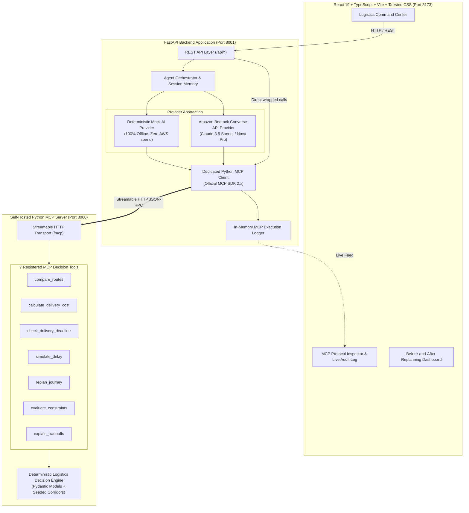

# RouteWise AI — Smarter Decisions for Every Journey
### Autonomous AI Travel & Logistics Decision Agent | Amazon Developer Hackathon: Build, Ship, Shape

[](LICENSE)
[](https://python.org)
[](https://fastapi.tiangolo.com)
[](https://react.dev)
[](https://typescriptlang.org)
[](https://modelcontextprotocol.io)
[](https://aws.amazon.com/bedrock/)

---

## 1. Executive Summary & Problem Statement

Ordinary consumer navigation applications (such as Google Maps or Waze) excel at a single task: calculating turn-by-turn road geometry and traffic congestion. However, **real-world shippers, dispatchers, freight forwarders, and business travelers do not just need a route — they need to make multidimensional logistics decisions**:

1. **Multimodal Tradeoffs:** Should freight travel via electrified rail, express highway truck, standard consolidation road, or regional air priority?
2. **Hard Constraint Enforcement:** If air cargo arrives 2 hours faster but exceeds the ₹2,000 budget by ₹1,200, it is **infeasible**, not "optimal".
3. **Punctuality & Arrival Buffer Margins:** An arrival scheduled 10 minutes before a warehouse delivery deadline carries catastrophic risk compared to an arrival scheduled 1.8 hours early.
4. **Disruption & Resilient Replanning:** When an unexpected 2-hour rail track delay strikes, ordinary GPS still guides you to the delayed train station. A true decision agent must evaluate the delay, detect the violated deadline, and autonomously pivot to a feasible alternative with transparent cost/duration deltas.

**RouteWise AI** is designed specifically to solve this decision problem. It provides an autonomous logistics command center backed by a self-hosted **Model Context Protocol (MCP)** server over **Streamable HTTP**, an AI agent orchestrator powered by the **Amazon Bedrock Converse API**, and a mathematical decision engine that never hallucinates prices or arrival windows.

---

## 2. System Architecture



---

## 3. Real MCP Server & Tool Specifications

RouteWise AI runs an independent Python MCP server over **Streamable HTTP** implementing the official Model Context Protocol specifications (`mcp>=2.0.0`). It exposes 7 typed decision tools:

1. `compare_routes`: Multimodal candidate ranking against budget, deadline, payload weight, and decision priority.
2. `calculate_delivery_cost`: Itemized freight tariff calculations in ₹ INR, including weight allowances, handling surcharges (Fragile, Perishable, Document), and cargo insurance.
3. `check_delivery_deadline`: Timezone-aware arrival calculations (`Asia/Kolkata` IST) evaluating margin buffers (On-Time, At-Risk, Late).
4. `simulate_delay`: Injects transit delay bottlenecks or cancellations for resilience testing.
5. `replan_journey`: Automatically re-evaluates all candidate options post-disruption, computing cost and duration variance metrics.
6. `evaluate_constraints`: Hard constraint validation enforcing budget, deadline window, and vehicle capacity.
7. `explain_tradeoffs`: Multi-criteria tradeoff synthesis comparing cost, duration, reliability %, and carbon emissions.

---

## 4. Operational Modes: Mock vs Amazon Bedrock

| Feature | Mode A: Deterministic Mock Mode (Default) | Mode B: Amazon Bedrock Mode |
| :--- | :--- | :--- |
| **AWS Credentials Required** | **No** (Zero configuration, runs immediately) | Yes (AWS CLI profile or environment keys) |
| **Cloud Billing / Cost** | **$0.00** (Runs 100% locally offline) | Uses Amazon Bedrock token pricing |
| **MCP Tool Execution** | **Real MCP Client over Streamable HTTP** | **Real MCP Client over Streamable HTTP** |
| **NLU & Reasoning** | Deterministic rule-based extraction | Claude 3.5 Sonnet / Nova Pro Converse API |
| **Guardrails** | Bounded local execution | Hard-capped at max 5 agent turns per turn |
| **Failover Behavior** | Always available | Clear authentication guidance if credentials missing |

---

## 5. Quick Start & Installation

### Prerequisites
- Python 3.11+
- Node.js 18+ and npm
- Git

### 1. Clone & Set Up Python Virtual Environment
```bash
git clone https://github.com/your-username/RouteWise-AI.git
cd RouteWise-AI

# Create virtual environment with Python 3.11
python -m venv .venv

# Activate virtual environment
# Windows PowerShell:
.venv\Scripts\activate
# Linux/macOS:
source .venv/bin/activate

# Install backend dependencies
pip install -r backend/requirements.txt
```

### 2. Set Up Frontend
```bash
cd frontend
npm install
cd ..
```

### 3. Launch All Services with a Single Command
```bash
python scripts/run_local.py
```

This single command launches:
1. **MCP Server** on `http://127.0.0.1:8000` (MCP endpoint: `http://127.0.0.1:8000/mcp`)
2. **FastAPI Backend** on `http://127.0.0.1:8001` (Docs: `http://127.0.0.1:8001/docs`)
3. **React Frontend** on `http://localhost:5173`

---

## 6. How to Verify Genuine MCP Protocol Execution

Run the included verification script to test real MCP Streamable HTTP handshake, tool discovery, and execution without needing the frontend or AWS:

```bash
# Terminal 1: Start MCP server
python mcp_server/server.py

# Terminal 2: Run verification script
python scripts/test_mcp_connection.py
```

---

## 7. Running the Automated Test Suite

RouteWise AI includes a comprehensive automated test suite with **19 automated pytest integration tests** covering the logistics engine, MCP server, MCP client, Bedrock Converse loop, and API endpoints:

```bash
# Set PYTHONPATH and execute pytest
pytest backend/tests/ mcp_server/tests/ -v
```

### Frontend Production Build Check
```bash
cd frontend
npm run build
```

---

## 8. Primary Hackathon Demonstration Scenario

### Corridor: Vijayawada → Visakhapatnam (~350 km Coastal Corridor)

1. **User Request:**
   > *"Plan a delivery from Vijayawada to Visakhapatnam within six hours, with a maximum budget of ₹2,000. Prefer a reliable option."*
2. **Initial Grounded Selection:**
   - **Recommended:** `Andhra Express Freight Rail (Vande Cargo)` (RAIL)
   - **Cost:** ₹1,450.00 (within ₹2,000 budget limit)
   - **Duration:** 4.2 hours (well ahead of 6.0h deadline; +1.8h buffer)
   - **Historical Reliability:** 94%
3. **Disruption Injection:**
   - A 2.0-hour delay strikes the rail corridor near Rajahmundry.
   - Transit duration increases to **6.2 hours**, violating the hard 6.0h deadline.
4. **Autonomous Replanning:**
   - RouteWise triggers `replan_journey` via MCP.
   - Pivots to `Coastal Corridor Highway Express (NH16)`.
   - **Restored Duration:** 5.5 hours (on-time arrival restored).
   - **Cost Variance:** ₹1,100.00 (saves ₹350 vs original rail budget!).
5. **Honest Infeasibility Test:**
   - If constraints are tightened to 3.0 hours deadline and ₹1,500 budget, the engine **honestly refuses** to endorse an impossible plan, explaining that Air (2.3h) costs ₹3,200 and Rail (₹1,450) takes 4.2h.

---

## 9. Security, Cost & Cloud Safeguards

- **No Stored Credentials:** AWS secrets are never saved in source code, committed files, or client-side assets.
- **Least-Privilege IAM:** Only requires `bedrock:InvokeModel` and `bedrock:Converse` permissions.
- **Bounded Iterations:** AI agent tool-calling loops are hard-capped at 5 turns per request.
- **Zero Required Cloud Spend:** Deterministic Mock Mode functions 100% locally.

---

## 10. Documentation Index

- [System Architecture & Design](docs/ARCHITECTURE.md)
- [MCP Protocol & Tool Schemas](docs/MCP_INTEGRATION.md)
- [AWS Bedrock Setup Guide](docs/AWS_SETUP.md)
- [Step-by-Step Judge Demonstration Script](docs/DEMO_SCRIPT.md)
- [Troubleshooting Guide](docs/TROUBLESHOOTING.md)

---

## 11. License

This project is licensed under the MIT License — see the [LICENSE](LICENSE) file for details.
