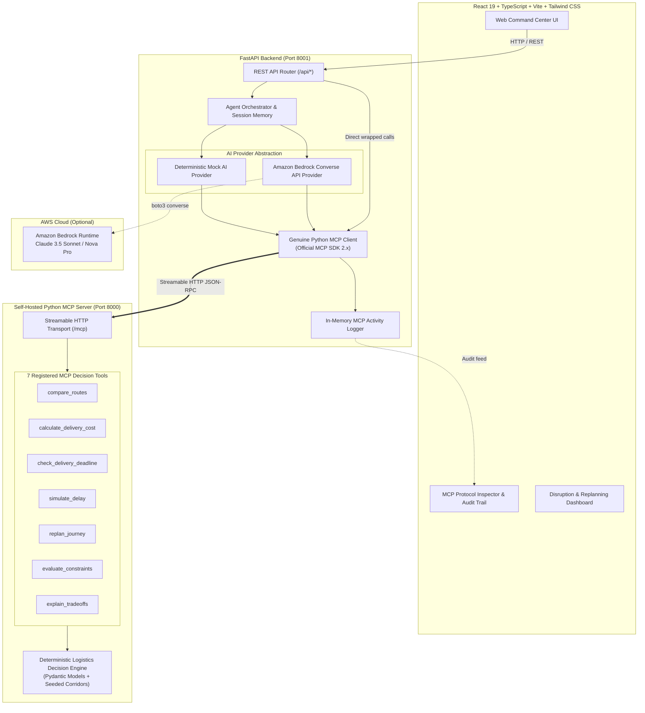

# RouteWise AI — Architecture & Design Document

## 1. Executive Overview

**RouteWise AI** is an autonomous, multimodal travel and logistics decision agent developed for the **Amazon Developer Hackathon: Build, Ship, Shape** (Alexa+ Track & AWS Builder Challenge).

Unlike consumer navigation applications that simply plot GPS routes and calculate road traffic delays, RouteWise AI acts as a **strategic decision engine**. It evaluates candidate multimodal freight options (road, highway express, rail, and regional air), computes itemized costs in Indian Rupees (₹ INR), verifies timezone-aware deadline margins, enforces inviolable hard constraints (budget, vehicle payload capacity, deadline windows), and autonomously recovers when disruptions strike.

---

## 2. High-Level System Architecture

---

## 3. Core Architectural Modules

### A. Independent MCP Server (`mcp_server/server.py`)
- Built on the official Model Context Protocol Python SDK (`mcp` 2.x).
- Uses **Streamable HTTP** transport on port `8000` with the `/mcp` endpoint and `/health` monitoring route.
- Exposes 7 typed, fully documented tools with JSON Schema validation.
- Operates independently of the backend API and frontend.

### B. Genuine MCP Client (`backend/app/mcp_client/client.py`)
- Connects to the MCP server over Streamable HTTP using `streamable_http_client` and `ClientSession`.
- Performs the standard MCP initialization handshake (`session.initialize()`).
- Discovers tools dynamically using `session.list_tools()`.
- Dispatches tool executions via `session.call_tool()`.
- Records real-time execution durations, input arguments, and structured responses in `mcp_activity_logger`.

### C. Deterministic Logistics Engine (`backend/app/logistics/`)
- Independent of LLMs to guarantee reproducibility and mathematical precision.
- Strongly-typed domain models with Pydantic (`Location`, `JourneyOption`, `CostBreakdown`, `DeadlineEvaluation`, `ConstraintCheckResult`, `ReplanningResult`).
- Timezone-aware date and arrival handling (`Asia/Kolkata` / UTC+05:30).
- Pure scoring function balancing cost, duration, and historical reliability.
- **Honest Refusal Principle**: When no option satisfies all hard constraints, the engine explicitly reports infeasibility and points out the closest budget and duration alternatives.

### D. AI Provider Abstraction (`backend/app/providers/`)
- **Mode A (Mock Mode)**: Deterministic natural language processor parsing constraints and calling real MCP tools without needing AWS credentials or cloud billing.
- **Mode B (Amazon Bedrock Mode)**: Amazon Bedrock Converse API integration using `boto3`. Dynamically maps discovered MCP tools into Bedrock tool specifications and drives the model's tool-use loop with bounded turn limits.

### E. Frontend Application (`frontend/`)
- Modern logistics command center built with React 19, TypeScript, Vite, Tailwind CSS v4, Lucide icons, and Recharts.
- Deep navy/slate theme (`#070b14`, `#0f172a`) with restrained cyan and blue accents.
- Responsive design supporting desktop multi-column command center and mobile views.
